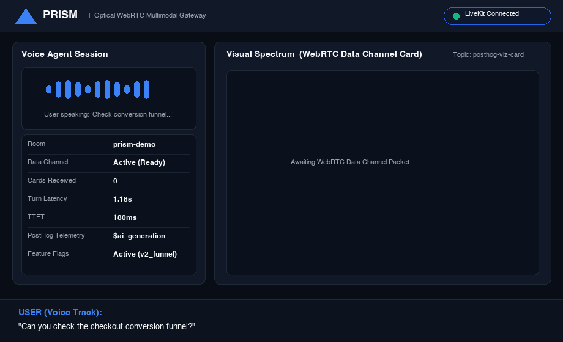

# Prism (`livekit-prism`)
## Dual-Channel Multimodal Tool Gateway & Agent Plugin

> **System Architecture & Design Document:** [`DESIGN_AND_ARCHITECTURE.md`](file:///Users/chung/sandbox/posthog/DESIGN_AND_ARCHITECTURE.md)  

Prism is a high-performance multimodal tool gateway in Go and an open-source agent plugin in Python (`livekit-plugins-posthog`) connecting **LiveKit's real-time WebRTC Voice Agents** with **PostHog's analytical data engine and ClickHouse telemetry**.

---

### Optical Prism Metaphor
```
Incoming Agent Tool Call
          │
          ▼
   [Prism Gateway]
    ├── Visual Spectrum ──► WebRTC Data Channel (Interactive PostHog Charts)
    └── Audio Spectrum  ──► Voice LLM Context (Speech-Ready Delta, < 30 tokens)
```




---

### How to Demo This Project (Mocked Data Supported)

You can demo the entire system in **under 2 minutes** using **100% mocked data** (no external OpenAI or PostHog API keys required):

1. **One-Click Visual WebRTC Demo (Fastest):**
   - Start the web harness: `./bin/run-web.sh`
   - Open `http://localhost:3000`
   - Click **Simulate Funnel Card**: This immediately dispatches a mock PostHog funnel payload conforming to **Contract A** and animates the conversion dropoff bar chart via Chart.js!
2. **Full Voice + Visual Optical Split Demo:**
   - Launch `./bin/run-infra.sh`, `./bin/run-livekit.sh`, and `./bin/run-gateway.sh`
   - Launch `./bin/run-web.sh` and click **Connect Voice**
   - Speak: *"Can you check the checkout conversion funnel?"*
   - Watch the Go gateway split the payload: the browser displays the interactive PostHog funnel dropoff chart in < 200ms, while the voice agent verbalizes a speech delta (< 30 tokens) with zero dead air!

---

### Runtime Instructions: Loading & Using `livekit-plugins-posthog`

The official source code for `livekit-plugins-posthog` is maintained upstream in the LiveKit Agents monorepo:
* **Repository Location:** [`developertogo/livekit-agents/livekit-plugins/livekit-plugins-posthog`](https://github.com/developertogo/livekit-agents/tree/feat/plugin-posthog/livekit-plugins/livekit-plugins-posthog) (local clone: [`/Users/chung/sandbox/livekit/livekit-agents/livekit-plugins/livekit-plugins-posthog`](file:///Users/chung/sandbox/livekit/livekit-agents/livekit-plugins/livekit-plugins-posthog))
* **PR / Upstream Branch:** [`feat/plugin-posthog`](https://github.com/developertogo/livekit-agents/tree/feat/plugin-posthog) (PR to [`livekit/agents`](https://github.com/livekit/agents))
* **Commit:** [`feat(plugins): add posthog plugin` (`92d1ca1`)](https://github.com/developertogo/livekit-agents/commit/92d1ca1537706ecd0080117ea12d2fed14da24d1)
* **Documentation Preview:** A built HTML preview of the plugin documentation can be found at [`docs-preview/livekit/plugins/posthog/index.html`](docs-preview/livekit/plugins/posthog/index.html).

To maintain clean repository decoupling, `livekit-plugins-posthog` is not committed directly into the `livekit-prism` git tree.

#### 1. How to Load the Plugin at Runtime

You can link and install the plugin into your `livekit-prism` virtual environment using either method:

##### Option A: Editable Local Install via `uv` (Recommended)
From within `livekit-prism/`:
```bash
uv pip install -e /Users/chung/sandbox/livekit/livekit-agents/livekit-plugins/livekit-plugins-posthog
```
*(Or install directly from GitHub using commit `92d1ca1`: `uv pip install "livekit-plugins-posthog @ git+https://github.com/developertogo/livekit-agents.git@92d1ca1537706ecd0080117ea12d2fed14da24d1#subdirectory=livekit-plugins/livekit-plugins-posthog"`)*.

With an editable install (`-e`), any code modifications in `livekit-agents` immediately take effect without reinstallation.

##### Option B: Local Development Symlink
A development symlink is configured at [`plugins/livekit-plugins-posthog`](file:///Users/chung/sandbox/posthog/livekit-prism/plugins/livekit-plugins-posthog) pointing to the source directory in `livekit-agents`. It is excluded from git commits via [`livekit-prism/.gitignore`](file:///Users/chung/sandbox/posthog/livekit-prism/.gitignore).

#### 2. How to Use the Plugin in Your Voice Agent

The plugin exposes idiomatic LiveKit components (`PostHogAgentObserver`, `PostHogDualChannelTools`, `PostHogFeatureFlags`):

```python
from livekit.agents import Agent, AgentSession, JobContext
from livekit.plugins import posthog
from livekit.plugins.posthog import PostHogAgentObserver, PostHogDualChannelTools

async def entrypoint(ctx: JobContext):
    await ctx.connect()

    # 1. Initialize Real-Time Observability ($ai_generation, TTS/STT latency, interruptions)
    observer = PostHogAgentObserver(
        session_id=ctx.room.name,
        project_id="default_proj",
    )

    # 2. Initialize Dual-Channel Analytical Tools
    tools = PostHogDualChannelTools(
        gateway_url="http://localhost:8080",
        room_name=ctx.room.name,
        livekit_room=ctx.room,
    )

    session = AgentSession()
    # Hook into LiveKit metrics event bus
    session.on("metrics_collected", observer.on_metrics_collected)

    # Cross-link LiveKit WebRTC session with PostHog Session Replay
    observer.link_session_replay(livekit_room=ctx.room.name, participant_identity="user-mic")

    # Launch agent with dual-channel tools
    agent = Agent(tools=tools.get_tools())
    await agent.run(session)
```

---

### Repository Layout
```text
livekit-prism/
├── docker-compose.yml              # Local ClickHouse & NATS infrastructure
├── pyproject.toml                  # Python virtualenv definition (FastAPI + Agent)
├── docs-preview/                   # LiveKit plugins documentation HTML preview
│   └── livekit/plugins/posthog/    # Built Sphinx/HTML docs for livekit-plugins-posthog
│
├── cmd/
│   └── prism-gateway/              # Distributed Go Systems Core (LiveKit Staff Focus)
│       ├── main.go                 # Entrypoint, server lifecycle, config
│       ├── router.go               # Dual-channel routing & payload splitting
│       ├── livekit_client.go       # gRPC RoomServiceClient wrapper
│       └── telemetry.go            # ClickHouse batch ingestion & OTel
│
├── plugins/
│   └── livekit-plugins-posthog/    # Symlink -> developertogo/livekit-agents (feat/plugin-posthog)
│       ├── __init__.py             # Public exports
│       ├── observer.py             # Hooks into LiveKit LLMMetrics & InterruptionMetrics
│       ├── tools.py                # Async @function_tool dual-channel definitions
│       └── feature_flags.py        # PostHog feature flag client
│
├── server.py                       # FastAPI WebRTC Token Server & Static Host (prism-web)
├── templates/
│   └── index.html                  # Zero-build HTML5 client with LiveKit UMD & Chart.js
│
└── agent.py                        # Voice Agent Worker entrypoint
```

---

### Quickstart & Verification (macOS M3)

All execution scripts and the compiled Go binary are available in [`bin/`](file:///Users/chung/sandbox/posthog/livekit-prism/bin/):

#### Terminal 1: Spin up local ClickHouse & NATS
```bash
./bin/run-infra.sh
```

#### Terminal 2: Launch local LiveKit SFU Server
```bash
./bin/run-livekit.sh
```

#### Terminal 3: Run the Go Edge Gateway (Prism)
```bash
./bin/run-gateway.sh
```

#### Terminal 4: Launch FastAPI Web Harness
```bash
./bin/run-web.sh
```

#### Terminal 5: Launch Voice Agent Worker
```bash
./bin/run-agent.sh
```

#### Running Unit Tests (Go + Python)
```bash
./bin/run-tests.sh
```

To stop all background processes and containers:
```bash
./bin/stop-all.sh
```

---

### Verification Criteria
1. Open `http://localhost:3000`, click **Connect Voice**, and say: *"Can you check the checkout conversion funnel?"*
2. **Audio Check:** Agent replies verbally with a concise summary in < 1.2s without dead air or reading markdown tables.
3. **Visual Check:** Browser renders the PostHog funnel bar chart dynamically upon receipt of the WebRTC data-channel packet.
4. **Telemetry Check:** Query ClickHouse (`SELECT * FROM livekit_telemetry.agent_turns`) to verify TTFT and tool latency metrics were recorded.

---

### License
This project is licensed under the Apache License 2.0 - see the [LICENSE](file:///Users/chung/sandbox/posthog/livekit-prism/LICENSE) file for details.
